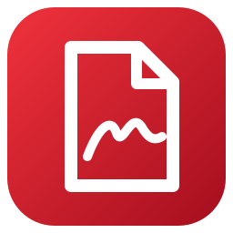
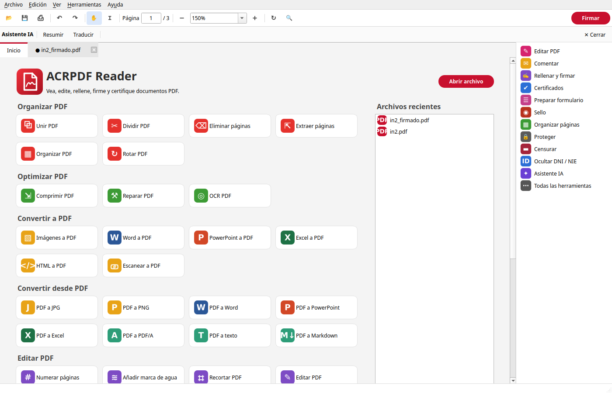

<p align="center">
  
</p>

<h1 align="center">ACRPDF Reader</h1>

<p align="center">
  <b>Alternativa de código abierto a Adobe Acrobat, pensada para Linux.</b><br>
  Ver, editar, rellenar formularios, firmar con certificado digital, sellar, organizar,
  convertir, comprimir y proteger documentos PDF, con las herramientas al estilo de iLovePDF.
</p>

---



ACRPDF Reader nace para cubrir en Linux lo que normalmente obliga a usar Adobe Acrobat o
servicios web: firmar contratos con el certificado de la FNMT, rellenar y crear formularios,
estampar sellos o comprimir y convertir PDF. Todo se procesa en tu equipo; los documentos no
se suben a ningún servidor (salvo el asistente IA opcional, cuando eliges un proveedor en
línea).

> Proyecto independiente, sin relación con Adobe Inc. ni con iLovePDF. *Adobe* y *Acrobat*
> son marcas de Adobe Inc.; *iLovePDF* es marca de sus titulares.

## Plataforma probada

Desarrollado y probado en:

| Componente | Versión |
|---|---|
| Sistema | **Ubuntu 26.04.1 LTS** (kernel 7.0, GNOME sobre Wayland) |
| Python | 3.14.4 |
| Qt / PyQt6 | 6.11 |
| PyMuPDF | 2.0 |
| pyHanko | 0.38 |
| Ghostscript | 10.06 |
| LibreOffice | 26.2 |
| Tesseract | 5.5 |

Otras distribuciones basadas en Debian deberían funcionar compilando el paquete desde el
código (ver más abajo), pero no se han probado.

## Funciones

### Editor

| Grupo | Funciones |
|---|---|
| **Rellenar y firmar** | Rellenar formularios escribiendo sobre la página (Tab pasa al siguiente campo), añadir texto con cualquier tipografía instalada, marcas ✓ y ✗, firma manuscrita escrita, dibujada o en PNG/SVG. Las firmas colocadas se pueden mover, redimensionar o borrar con un clic |
| **Certificados** | Firma digital PAdES con `.p12`/`.pfx` o con el certificado guardado en Firefox/Thunderbird, vista previa de la apariencia, colocación sobre la página, firma invisible, certificación (DocMDP), sello de tiempo, validación y solicitud de firmas por correo |
| **Preparar formulario** | Campos de texto, casillas, botones de opción, desplegables, listas y campos de firma; detección automática de campos; aplanado |
| **Comentar** | Resaltar, subrayar, tachar, notas, cuadros de texto, formas, flechas y dibujo libre |
| **Editar PDF** | Añadir o editar texto, imágenes, recortar páginas, marca de agua y numeración |
| **Sello** | Sellos vectoriales (APROBADO, RECIBIDO, CONFIDENCIAL…) y sellos de imagen |
| **Organizar páginas** | Reordenar arrastrando miniaturas, rotar, duplicar, eliminar, insertar, extraer y dividir |
| **Proteger / Censurar** | Cifrado AES-256 con permisos, quitar contraseña y censura real del contenido |
| **Proteger DNI / NIE** | Marca de agua «SOLO PARA {trámite} · {fecha}» configurable (tamaño, grosor, intensidad, separación, ángulo, color), franja «DNI para … trámite» y enmascarado AEPD (`***4567**`), también en fotos del DNI mediante OCR |
| **Asistente IA** | Resumir y traducir conservando el diseño, con Claude, ChatGPT, DeepSeek u Ollama (local) |

Al abrir un documento firmado se muestra si las firmas son válidas, si la identidad del
firmante no se pudo verificar o si alguna firma no es válida. Las operaciones que afectan a
todo el documento muestran una vista previa antes de aplicarse o guardarse.

### Herramientas PDF

| Organizar | Optimizar | Convertir a PDF | Convertir desde PDF | Editar | Seguridad |
|---|---|---|---|---|---|
| Unir | Comprimir (3 niveles) | Imágenes (JPG, PNG, SVG…) | JPG / PNG | Numerar páginas | Desbloquear |
| Dividir | Reparar | Word | Word | Marca de agua | Proteger |
| Eliminar páginas | OCR | PowerPoint | PowerPoint | Recortar márgenes | Firmar |
| Extraer páginas | | Excel | Excel | Formularios | Censurar |
| Ordenar | | HTML o URL | PDF/A | | Proteger DNI/NIE |
| Rotar | | Escanear (móvil o escáner) | Texto · Markdown | | Comparar |

También permite crear **flujos de trabajo** (encadenar herramientas y reutilizarlos) e
incluye la impresora virtual **ACRPDF**, que guarda en `~/PDF` lo que imprimas desde
cualquier programa.

Idiomas de la interfaz: español, inglés, francés y portugués (según el idioma del sistema).

## Instalación

Descarga el paquete `.deb` de la página de
[Releases](https://github.com/felipemogro/AcrPDF/releases) e instálalo:

```bash
sudo apt install ./acrpdf_2.1.0_amd64.deb
```

APT instala las dependencias (Ghostscript, utilidades NSS, CUPS) y, como recomendadas,
LibreOffice, Tesseract en español e inglés y SANE. La aplicación lleva su propio entorno de
Python en `/opt/acrpdf` y no modifica los paquetes Python del sistema.

Desinstalar: `sudo apt remove acrpdf`.

## Compilar desde el código

Requisitos: `python3` (3.14 en Ubuntu 26.04), [`uv`](https://docs.astral.sh/uv/), `make`
y `dpkg-deb`.

```bash
git clone https://github.com/felipemogro/AcrPDF.git
cd AcrPDF
make venv     # entorno de desarrollo en .venv
make run      # ejecutar desde el código
make test     # tests
make deb      # genera releases/acrpdf_<versión>_amd64.deb
make install  # instala el paquete generado
```

`make help` lista todos los objetivos.

## Uso rápido

**Firmar con certificado digital.** Abre el PDF, pulsa *Firmar* → *Firmar ▾* → *Añadir firma…*
para crear tu firma manuscrita (opcional). Después ve a *Certificados* → *Firmar
digitalmente*, dibuja el área, elige el certificado (los de Firefox se detectan solos), revisa
la vista previa, ajusta la posición y pulsa *Firmar*. El documento se comprime en memoria
antes de firmarse y la cadena de certificación (por ejemplo, *AC FNMT Usuarios*) se incluye
para que los validadores reconozcan la firma.

**Proteger una copia del DNI.** *Proteger DNI / NIE*: escribe el trámite, ajusta la marca de
agua, revisa la vista previa y pulsa *Guardar como…*. Con *Fusionar en una imagen*, ni la
marca ni el número ocultado se pueden recuperar.

**Escanear con el móvil.** *Escanear a PDF*: escanea el código QR con el móvil conectado a la
misma red Wi-Fi y fotografía cada página. Se usa la tarjeta de red física aunque haya una VPN
o Docker activos.

**Asistente IA.** En *Edición → Preferencias → IA* elige Claude, ChatGPT, DeepSeek u Ollama y
pega la clave de API (se guarda en el llavero del sistema). Con los proveedores en línea, el
texto del documento se envía a esa empresa; Ollama funciona sin conexión.

## Privacidad

- Las contraseñas de los certificados nunca se escriben en disco; si eliges recordarlas, se
  guardan en el llavero del sistema.
- Los certificados importados se copian en `~/.local/share/acrpdf/certificates` con permisos
  `0600`. Los de Firefox se exportan a memoria solo durante la firma.

## Estructura

```
src/acrpdf/   aplicación (app, document, viewer, overlay, ops, tools, signing,
              certstore, dni, scan, ai, i18n, dialogs)
po/           traducciones
printer/      impresora virtual CUPS
packaging/    construcción del paquete .deb
data/         entrada de escritorio y metadatos AppStream
tests/        tests (pytest)
```

## Licencia

[GNU AGPL v3 o posterior](LICENSE). Construido con [PyMuPDF](https://pymupdf.readthedocs.io),
[pyHanko](https://pyhanko.readthedocs.io), [PyQt6](https://www.riverbankcomputing.com/software/pyqt/),
[pdf2docx](https://github.com/ArtifexSoftware/pdf2docx), [Ghostscript](https://ghostscript.com)
y [LibreOffice](https://www.libreoffice.org).
